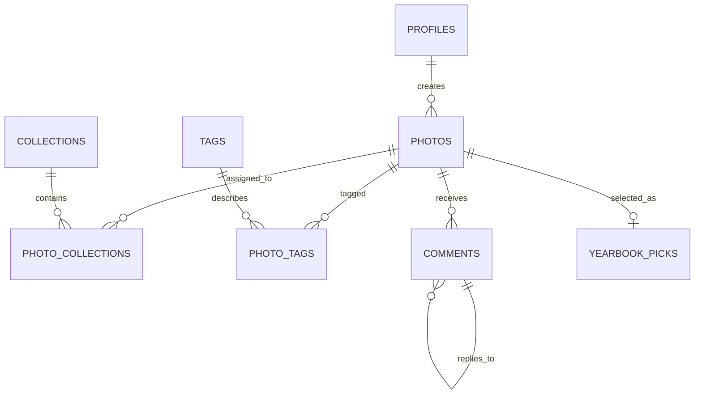
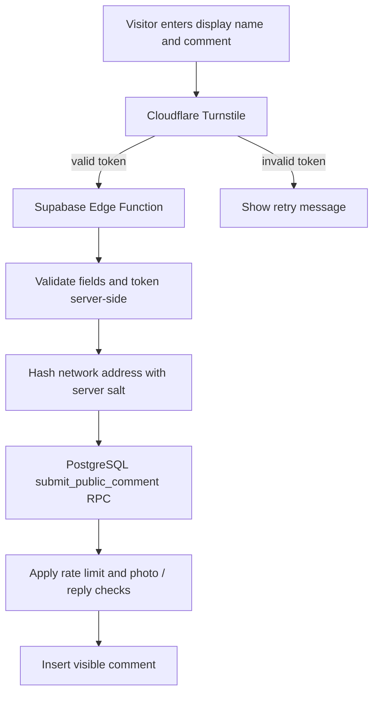

# MEMORYVERSE — Technical Architecture

## 1. Product contract

MEMORYVERSE is a class memory archive for the 2026–2029 school years. Its primary job is to preserve ordinary moments as carefully as formal events, then make those materials searchable and reusable for the final-year video.

### Audience and access

- **Viewer:** anyone who has the website link. No account is needed to browse published collections and photos.
- **Commenter:** anyone can write a display name and comment without creating an account. A Cloudflare Turnstile challenge is required in the hosted version. The name is user-entered and is not an identity check.
- **Curator:** one trusted account (the site owner) can upload and organize photos, assign metadata, select yearbook images, and moderate comments.

The page sends `noindex,nofollow,noarchive` to crawlers as a courtesy. A public link and a `noindex` tag do not make content private. Files in the public Storage bucket can be opened directly if someone has the object URL.

## 2. Information architecture

| Space | Purpose | Example collections |
|---|---|---|
| Everyday | Daily school life | Before the bell, break time, after class |
| Chaos | Funny / unexpected episodes | The Punishment Files, Oops Moments, behind the scenes |
| Milestones | Events and class activities | October days, school trips, performances |
| Our People | People and groups | Portraits, friend groups, homeroom teacher |
| Little Things | Objects and atmosphere | Classroom corners, notebooks, windows, schoolyard |
| The Yearbook | Curated selection for the year-end film | The Final Cut |

A photo can belong to multiple collections. Do not copy the physical image file to create another album entry; create another `photo_collections` relation instead.

### Collection presentation types

- `film-strip`: horizontal sequence of frames.
- `case-files`: archival / dossier treatment for playful episodes such as class punishments.
- `exhibition`: one image treated as a gallery work.
- `portrait-wall`: irregular portrait arrangement.
- `scrapbook`: image plus small notes and context.

The frontend currently provides shared collection cards and filtering. The values are already modeled in the database so collection-specific transitions can be expanded without changing the underlying photo records.

## 3. Data model



### Tables

| Table | Important columns | Notes |
|---|---|---|
| `profiles` | `id`, `display_name`, `role` | Auth user profile; role is `member` or `curator`. |
| `collections` | `slug`, `title`, `space`, `layout_type`, `cover_image_path`, `sort_order`, `is_published` | Defines memory spaces and individual collections. |
| `photos` | `title`, `caption`, `taken_at`, `storage_path`, `thumbnail_path`, `width`, `height`, `sha256`, `is_published`, `created_by` | One row per original photo. SHA-256 unique index helps avoid duplicate uploads. |
| `photo_collections` | `photo_id`, `collection_id` | Many-to-many; one photo can appear in several collections. |
| `tags` | `name` | Normalized tags such as `ra chơi`, `hậu trường`, `bị phạt`. |
| `photo_tags` | `photo_id`, `tag_id` | Many-to-many between photos and tags. |
| `comments` | `photo_id`, `parent_id`, `author_name`, `body`, `is_hidden`, `ip_hash` | Supports one-level or nested reply relationships via `parent_id`; curator can hide/delete. |
| `yearbook_picks` | `photo_id`, `pick_type`, `sort_order`, `note` | `candidate`, `favorite`, `essential`, or `final`. |

### Storage layout

Supabase Storage bucket: `memoryverse`.

```text
memoryverse/
  originals/<uuid>.<original-extension>
  thumbs/<uuid>.webp
```

The original file is preserved. A WebP derivative is generated in the browser for listing and quick preview. Storage object paths are stored in `photos`, never in client-side hardcoded lists.

## 4. Main data flows

### Upload flow

1. Curator signs in through Supabase Auth.
2. Frontend reads `profiles.role`; the upload interface is enabled only when role is `curator`.
3. Curator selects one or many raster photos, one or many collections, an optional date, a shared caption, and comma-separated tags.
4. Browser calculates SHA-256 and checks for an existing photo with the same hash.
5. Browser uploads the original and a generated WebP thumbnail to Storage.
6. Browser inserts one `photos` row, one or more `photo_collections` rows, and the related `photo_tags` rows.
7. If a later database step fails, the frontend attempts to remove the newly created row and storage objects so the archive is not left with a broken partial upload.

Upload limit in this build: 30 MB per image. Supported formats: JPEG, PNG, WebP, AVIF. SVG and arbitrary files are rejected.

### Browse flow

1. Frontend fetches published collections and photos through the Supabase anon key.
2. RLS permits read-only access to published records.
3. Photo rows are joined to collection IDs and tag names in separate requests.
4. Frontend filters on the client by space, collection, title, caption and tag.
5. The photo viewer loads one selected image at a time; browser `loading="lazy"` is used for the grid.

### Comment flow



- A visitor does not need a Supabase account.
- The client cannot insert directly into `comments`.
- Edge Function uses the service-role credential only on the server.
- Turnstile is verified server-side; accepting a client-supplied success flag is not sufficient.
- PostgreSQL limits one hashed network fingerprint to 8 comments per hour.
- Raw IP addresses are not stored in the comments table.
- `author_name` is a display name typed by the visitor; it can be impersonated. Do not treat it as verified identity.

## 5. Access-control matrix

| Action | Anonymous visitor | Authenticated member | Curator |
|---|---:|---:|---:|
| Read published collections/photos | Yes | Yes | Yes |
| Read visible comments | Yes | Yes | Yes |
| Submit a comment (CAPTCHA) | Yes | Yes | Yes |
| Upload original / thumbnail | No | No | Yes |
| Create or edit collections | No | No | Yes |
| Assign photos to collections/tags | No | No | Yes |
| Change yearbook picks | No | No | Yes |
| Hide / delete comments | No | No | Yes |

The frontend hides curator controls for visitors, but actual enforcement is in PostgreSQL RLS and Storage policies. The `service_role` key must never be placed in `config.js` or shipped to a browser.

## 6. Performance and mobile rules

- CSS-first layout with responsive breakpoints; no large frontend framework is required.
- Grid thumbnails use WebP derivatives; original files remain untouched.
- Photo cards are lazy-loaded.
- Viewer displays the image with `object-fit: contain`, so portrait and landscape photos retain their proportions.
- Touch swipe changes the current image; vertical scroll remains available to reach comments below the image.
- Respect `prefers-reduced-motion` and avoid mandatory high-cost animation.
- Test at 320, 360, 390 and 430 px widths before publishing.

## 7. Privacy, moderation and backups

- Public bucket means direct image URLs can be opened or forwarded. Do not upload sensitive or embarrassing images without the people in them being comfortable with publication.
- `noindex` is only a crawler instruction, not an access-control layer.
- If some photos later need member-only access, put them in a private bucket and generate signed URLs only after member authorization; do not rely on hidden UI elements.
- Public comments require CAPTCHA and server-side rate limits. The curator can hide or delete comments. Names are unverified display names.
- Keep independent backups of originals and metadata. Supabase is the active store, not the only backup. Periodically export original files plus SQL/CSV metadata and verify a restore in a separate test project.

## 8. Explicit scope boundaries in this first build

Implemented now: public browse, space filters, collection cards, text search, photo viewer, previous/next/swipe navigation, visible comments and replies, public comment endpoint, bulk/single upload, multi-collection assignment, tags, duplicate hash check, Yearbook Pick toggle, and comment moderation UI.

Not yet implemented: editing collection titles from the UI, deleting/replacing photos from the UI, drag-reordering every frame, face recognition, automatic AI classification, member directory, video export, and automated offsite backup. These are intentionally postponed until the real archive has been connected and tested with the curator's photo set.
